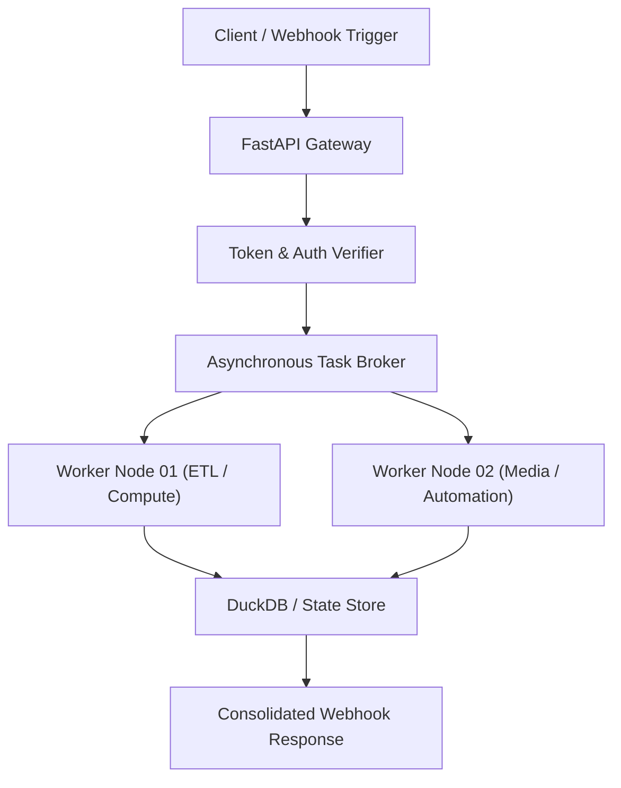

# ☁️ Toomer Cloud — Distributed Microservices Platform

[](https://opensource.org/licenses/MIT)
[](https://python.org)
[](https://docker.com)
[](https://fastapi.tiangolo.com)
[](#system-architecture)

> High-throughput, distributed cloud microservices engine engineered for resilient task processing, asynchronous event streams, and enterprise workflow automation.

---

## 🏛️ System Architecture



---

## ⚡ Core Capabilities

- **Distributed Task Scheduling**: Asynchronous background job distribution with zero unhandled event loss.
- **Resilient Microservices**: Fault-tolerant service discovery, circuit-breaker retry logic, and exponential backoff.
- **Enterprise Security**: Strict environment isolation, rate-limiting, and header-based credential verification.
- **Production Telemetry**: Real-time logging, health check probes (`/healthz`), and system metrics.

---

## 🚀 Quickstart

### Prerequisites
- Python 3.10+
- Docker & Docker Compose (Optional for containerization)

### Installation
```bash
# Clone the repository
git clone https://github.com/kushaggarwal2007-byte/toomer-cloud.git
cd toomer-cloud

# Set up virtual environment
python -m venv venv
source venv/bin/activate  # On Windows: venv\Scripts\activate

# Install dependencies
pip install -r requirements.txt
```

### Configuration
Create a `.env` file in the project root:
```env
ENVIRONMENT=production
LOG_LEVEL=INFO
HOST=0.0.0.0
PORT=8000
```

### Running Locally
```bash
uvicorn app.main:app --host 0.0.0.0 --port 8000 --reload
```

---

## 🛡️ License & Author

Developed & maintained by **Kush Aggarwal** ([@kushaggarwal2007-byte](https://github.com/kushaggarwal2007-byte)).  
Released under the [MIT License](LICENSE).
